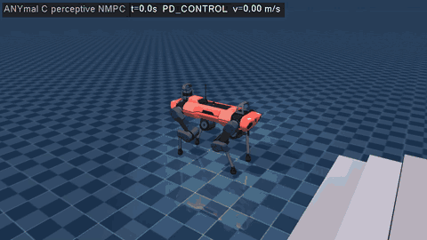

# anymal_perceptive_mujoco

Perceptive NMPC for ANYmal C in MuJoCo, in **plain C++ and CMake: no ROS, no colcon, no ament**.
The elevation map comes **straight from the MuJoCo scene**: the controller casts one `mj_ray` per grid
cell. It does not use elevation_mapping, grid_map, convex_plane_decomposition or the other perception
packages.



*Lock-step run over the terrain course (2.5x speed): 5 stairs up (0.10 m rise), platform, stairs down, rough
blocks and a beam. Green cells are steppable, red cells are not; the coloured spheres and discs are the planned
footholds and their foot placement regions.*

## How it works

```
 MuJoCo scene ──mj_ray per cell──▶ TerrainMap (raw → filled → smooth / inflated / steppable / edge distance)
                                        │  20 Hz, robot-centric 3.2 x 3.2 m, 2 cm
                                        ▼
 velocity command ──▶ PerceptiveReferenceManager (before every MPC solve)
                        1. base reference lifted onto the terrain plane under the feet (z, pitch, roll)
                        2. joint posture reference by leg IK onto the terrain
                        3. foothold + convex region per future stance phase
                        4. swing z splines: lift-off / touch-down heights + obstacle apex
                                        │
                                        ▼
 OCS2 centroidal NMPC (SLQ, 50 Hz) ── soft constraints: friction cone, foot placement region, swing clearance,
                                        │                  shank clearance
                                        │
                                        ▼
 RNEA whole-body torques (1 kHz) ──▶ MuJoCo
```

| Part | File | What it does |
|------|------|--------------|
| Elevation mapper | `terrain/MujocoElevationMapper` | Vertical `mj_ray` per cell on a private `mjData`, filtered to the terrain geom groups (the robot uses groups 2/3, so its own body is never in the map) |
| Terrain map | `terrain/TerrainMap` | Hole filling, smoothing, local plane fit for steppability (slope + roughness), chamfer distance to the nearest edge, inflated layer for swing clearance, bilinear queries with gradients |
| Foothold planner | `terrain/FootholdPlanner` | Searches the steppable cells near the Raibert foothold, scoring distance to it, distance to edges and hysteresis. Builds an 8-gon region in the tangent plane |
| Reference manager | `reference_manager/PerceptiveReferenceManager` | Terrain-lifted base trajectory, IK posture, footholds and swing heights. Hands the map snapshot to the constraints |
| Constraints | `constraint/TerrainConstraints` | `FootPlacementConstraint`: `A p_foot + b >= 0` on future stance feet. `FootClearanceConstraint`: `p_z >= h_inflated(p_xy) + margin` in mid-swing. `ShankClearanceConstraint`: two points on every shank (30 % and 60 % of the way to the knee) stay above the inflated map, so the lower legs do not scrape step noses and risers |
| Swing planner | `foot_planner/SwingTrajectoryPlanner` | Cubic z splines: apex above `max(lift-off, touch-down, highest obstacle on the way)` |
| OCS2 problem | `PerceptiveLeggedInterface` | Centroidal (SRBD) dynamics, tracking cost, contact constraints and the perceptive terms |
| Controller | `controller/PerceptiveController`, `MujocoAnymalBridge` | FSM, velocity commands (integrated, kept within 10 cm of the base so the robot cannot run away downhill), MPC/MRT, RNEA + PD torques. MuJoCo and Pinocchio joints are matched by name |
| Visualisation | `visualization/TerrainVisualizer` | Map, footholds and base reference drawn as MuJoCo decoration geoms (GUI and recorder) |

`cmake/Ocs2Standalone.cmake` compiles the needed OCS2 libraries (core, oc, mpc, ddp, qp_solver,
robotic_tools, pinocchio_interface, centroidal_model) straight from `src/ocs2_ros2`. The upstream
CMakeLists are ament packages, so it does not use them.

One fix in the vendored OCS2 came with this package: `ThreadPool::runParallel` now waits for all helper
threads before rethrowing an exception. Before, a failed solve left helpers running on the solver's data,
which crashed the next solve.

## Build

Dependencies: CMake ≥ 3.16, GCC with C++17, Eigen3, Boost (system, filesystem, log), urdfdom, **pinocchio 3**
and **MuJoCo ≥ 3.0**. GLFW3 and OpenGL are optional; you need them for the GUI and `--record`.

```bash
sudo apt install build-essential cmake libeigen3-dev libboost-all-dev liburdfdom-dev libglfw3-dev libgl-dev ffmpeg
```

Pinocchio 3 (choose one, none needs ROS):

```bash
# a) pip, official wheels (cmeel). build.sh finds the prefix by itself.
#    cmeel-urdfdom-headers is needed because cmeel-urdfdom does not ship the urdf_model headers.
pip install pin cmeel-urdfdom-headers
# b) robotpkg apt repository (https://stack-of-tasks.github.io/pinocchio/download.html), then
export CMAKE_PREFIX_PATH=/opt/openrobots
# c) an existing ROS 2 install also works (export CMAKE_PREFIX_PATH=/opt/ros/$ROS_DISTRO); ROS itself is not used
```

MuJoCo: use the release tarball (or any install that has a CMake config):

```bash
wget https://github.com/google-deepmind/mujoco/releases/download/3.3.0/mujoco-3.3.0-linux-x86_64.tar.gz
tar -xzf mujoco-3.3.0-linux-x86_64.tar.gz -C ~/
export MUJOCO_DIR=~/mujoco-3.3.0
```

Build (from the repository root; output in `build/anymal_perceptive`):

```bash
src/anymal_perceptive_mujoco/scripts/build.sh
```

The script runs plain CMake:

```bash
cmake -S src/anymal_perceptive_mujoco -B build/anymal_perceptive -DCMAKE_BUILD_TYPE=Release -DMUJOCO_DIR=$MUJOCO_DIR
cmake --build build/anymal_perceptive -j
```

The package has a `COLCON_IGNORE`, so a `colcon build` of the ROS workspace skips it.

## Run

```bash
# interactive MuJoCo GUI on the terrain course (keyboard in the terminal, or an Xbox pad)
build/anymal_perceptive/anymal_perceptive_mujoco

# another scene
build/anymal_perceptive/anymal_perceptive_mujoco src/anymal_perceptive_mujoco/robots/anymal_c/scene_flat.xml

# scripted, deterministic run (lock-step: the physics waits for every MPC solve); exit code 0 = goal reached
build/anymal_perceptive/anymal_perceptive_mujoco --headless --vx 0.3 --goal-x 8.3 --log run.csv

# same, but the MPC is blind (assumes flat ground) - for comparison
build/anymal_perceptive/anymal_perceptive_mujoco --headless --vx 0.3 --goal-x 8.3 --blind

# offscreen video / GIF (ffmpeg; xvfb-run without a display)
src/anymal_perceptive_mujoco/scripts/make_gif.sh

# unit test (map + footholds on the stairs) and the closed-loop course test
(cd build/anymal_perceptive && ctest --output-on-failure)
```

| Key (terminal) / pad | Action |
|-----|--------|
| `1` / A | PASSIVE |
| `2` / B | PD stand-up |
| `3` / X | STANDING (MPC, stance) |
| `4` / Y | WALKING (MPC, standing trot) |
| `W` `S` / `A` `D` | forward / lateral velocity |
| `J` `L` | yaw rate |
| `G` / RB | next gait |
| `-` `=` | base height above the terrain |
| `M` | toggle the map / foothold display |
| `Q` | emergency stop |

Headless options: `--duration S`, `--vx V`, `--goal-x X`, `--gait NAME`, `--base-height H`, `--walk-start T`,
`--start-y Y`, `--log FILE.csv`, `--blind`, `--task FILE`, `--report-hits` (print every leg/body collision with the
terrain), `--record FILE.gif|mp4` with `--width --height --fps --scale --playback --map-stride`, `--no-map`.
The report at the end gives the distance reached, MPC/map timing, the time the legs or body touched the terrain
(feet excluded) and whether the robot fell.

## Results (headless, lock-step, `scene_terrain.xml`)

The shipped configuration (standing trot, shank clearance on) was run over the whole course (goal x = 8.3 m,
past the beam). Each run used one of 3 speeds (0.2, 0.3 and 0.4 m/s) and one of 6 start offsets across the course
(y = 0, ±0.05/0.15, ±0.3 m). Runs are not bit-identical: OCS2's parallel line search picks its step from whichever
thread finishes first, so repeated runs of the same variant can differ.

| Configuration | Runs | Course completed |
|---------------|------|------------------|
| shipped: standing trot + shank clearance | 40 | **37 (92 %)**: every failure came at the end of the stairs down or the first rough blocks |
| plain trot + shank clearance (`--gait trot`) | 18 | 13 (72 %) |
| trot without shank clearance | 9 | 6 |
| `--blind` (the MPC assumes flat ground) | 1 | 0: stuck at the first step, x = 1.24 m |
| `scene_flat.xml`, 0.4 m/s | 1 | 1 |

Timing on a 4-core cloud VM, one run at a time: MPC solve 7.4 ms on average (32 ms max) at 50 Hz, and the
elevation map update 18 ms at 20 Hz (161 x 161 rays plus post-processing on 2 threads; about 6 ms on the flat
scene). The course takes about 32 s at 0.3 m/s. With the CppAD code already generated, a headless run of the
course (36 s simulated) takes about 28 s of wall time.

## Configuration (`config/mpc/task.info`)

* `elevation_mapper`: resolution, size, rate, the geom groups the rays may hit, and `processing`
  (smoothing, foot radius, max roughness/slope, swing inflation).
* `perception`: base pitch/roll gains, IK posture reference, foot frame height, swing clearance and penalty
  parameters, and `foothold` (search radius, edge distances, region size, Raibert feedback).
* `swing_trajectory_config`: lift-off/touch-down velocity, swing height above the highest obstacle.
* `model_settings.recompileLibrariesCppAd`: generates the CppAD libraries in `/tmp/anymal_perceptive_mujoco`
  (about 30 s on the first run). Set it to `false` to reuse them on later runs.
* `controller`: PD stand-up, whole-body PD gains, `maxCommandLead` (position feedback on the velocity command).

To add your own terrain, put geoms in group 0 or 1 of any MuJoCo scene that includes `anymal_c.xml`.
`scripts/generate_terrain.py` regenerates the default course.

## Notes and limitations

* State estimation is perfect (taken from the simulator), and the map is noise-free geometry from the scene.
* The gait timing is fixed (standing trot: 0.30 s swing + 0.05 s four-leg stance). Obstacles wider than about one
  step length (~0.2 m at 0.3 m/s), such as a deep beam, call for steps the gait cannot make.
* Stair descents are the weak spot. In the rare failures the robot gains speed going down (up to about 2x the
  command), the SLQ solve fails a few times in a row, and the robot sits down at the bottom of the stairs.
* DDP does not enforce hard inequalities, so the friction cone, foot placement and swing clearance are relaxed
  barriers. If a solve fails, the controller restarts the solver and the robot keeps the last policy.
* While trotting, the base settles a few cm above the commanded height: the swing legs and the simple RNEA
  whole-body control have no base feedback.
