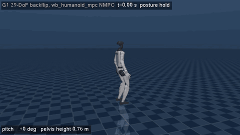

# g1_backflip_mujoco

Standing **backflip of the 29-DoF Unitree G1** in MuJoCo, built on the **whole-body NMPC of
[wb_humanoid_mpc](https://github.com/manumerous/wb_humanoid_mpc)** (OCS2 SQP + HPIPM, full rigid-body dynamics).
Plain C++ and CMake like the other packages of this repository: **no ROS, no colcon, no ament**.



## How it works

```
 keyframe guide (postures, pitch 0 -> -2 pi)            config/task.info: postures, guide
        │
        ▼
 offline plan: OCS2 SQP over the whole manoeuvre        stand, crouch, push, flight with tuck, landing, stand
   (multiple shooting, initialised with the guide)       whole-body dynamics, torque limits, friction, CoP, ...
        │ plan (state + input trajectories)
        ▼
 online NMPC: OCS2 SQP, 100 Hz, 1.4 s horizon            tracks the plan; mode schedule follows the measured
        │                                                lift-off / touchdown
        ▼
 joint torques = inverse dynamics of the MPC's wrenches and joint accelerations at the measured state
                 + joint PD to the MPC's joint positions / velocities (1 kHz)  ──▶  MuJoCo (29 torque motors)
```

| Part | File | What it does |
|------|------|--------------|
| wb_humanoid_mpc build | `cmake/WbHumanoidMpc.cmake` | Compiles the submodule `src/wb_humanoid_mpc` and its OCS2 fork (core, oc, mpc, ddp, sqp + HPIPM/BLASFEO, pinocchio interface) and `humanoid_common_mpc` / `humanoid_wb_mpc` from source, without ament. ROS-only files are left out |
| Dynamics fix | `src/wb_fixes/DynamicsHelperFunctions.cpp` | Fixed copy of the upstream file (see below), compiled instead of the original |
| OCP | `G1WbBackflipInterface` | Upstream whole-body dynamics (`WBAccelDynamicsAD`), friction cones, CoP, joint limits, foot / knee self-collision, stance foot constraint. Added: tracking of a full state / input trajectory, joint torque limits, feet and knees above the floor; no swing-foot constraints (both feet fly) |
| Fixed schedule | `BackflipReferenceManager` | Upstream reference manager with a fixed STANCE → FLY → STANCE schedule instead of the walking gait scheduler |
| Guide | `BackflipGuide` | Keyframes (time, posture, pitch); kinematically consistent in stance (feet on the footprint); velocities, joint accelerations and foot forces from splines |
| Plan | `BackflipPlanner` | One SQP over the 3 s manoeuvre, warm-started from the guide (~25 s); prints lift-off / touchdown state, flight angular momentum (constant if physical), peak torques against the limits |
| Controller | `controller/BackflipController`, `MujocoG1Bridge` | Online SQP NMPC (`SqpMpc` + `MPC_MRT_Interface`), lift-off / touchdown adaptation, joint torques. The 6 wrist joints are not in the MPC (as upstream) and are PD-held |

### The flip_base frame (no Euler singularity)

The MPC parameterises the base orientation with ZYX Euler angles, which are singular at ±90° pitch. The URDF used by
the MPC (`robots/g1_29dof/urdf/g1_29dof_flip.urdf`, generated by `scripts/generate_model.py`) has a massless root
`flip_base`, the pelvis turned by +90° about z: the backflip is then a rotation about the base x axis, the last
Euler angle, which is never singular. The bridge converts between the MuJoCo pelvis and `flip_base` (yaw and roll
unwrapped, so the pitch runs continuously from 0 to −2π).

### Fix in wb_humanoid_mpc's whole-body dynamics

`humanoid_common_mpc/src/pinocchio_model/DynamicsHelperFunctions.cpp` (upstream commit `6fb34bb`) has two issues
that do not show in slow walking but break a flip:

1. `computeBaseAcceleration()` treats the 6×6 floating-base block of the mass matrix as block diagonal (linear /
   angular) and drops the coupling `m [r_com]×`, which is only zero if the base origin is at the centre of mass.
   The base accelerations, and so the model, do not conserve momentum: in a first plan the flight angular momentum
   grew from −6.7 to −13.6 N m s.
2. pinocchio 3 `crba()` fills only the upper triangle of `data.M` across joints, but `computeBaseAcceleration()` and
   `computeJointTorques()` read lower-triangle entries (zero).

The copy in `src/wb_fixes/` solves the full 6×6 block with a branch-free Schur complement (closed-form 3×3 inverses,
CppAD safe) and symmetrises `data.M`. With it the planned flight angular momentum is constant to 1e-3 N m s.
The submodule itself is not modified.

## Build

Dependencies: CMake ≥ 3.16, GCC with C++20, Eigen3, Boost (filesystem, log), urdfdom, **pinocchio 3**,
**MuJoCo ≥ 3.0**, git and network access (submodules, BLASFEO / HPIPM via FetchContent). GLFW3 and OpenGL are
optional (GUI and `--record`).

```bash
sudo apt install build-essential cmake libeigen3-dev libboost-all-dev liburdfdom-dev libglfw3-dev libgl-dev ffmpeg
pip install "pin<4"                              # pinocchio 3 (or robotpkg / any pinocchio 3 install)
export MUJOCO_DIR=/path/to/mujoco-3.3.0          # MuJoCo release directory
```

From the repository root (checks out `src/wb_humanoid_mpc` and its OCS2 fork if needed; output in `build/g1_backflip`):

```bash
src/g1_backflip_mujoco/scripts/build.sh
```

The first run generates the CppAD libraries of the 23-joint whole-body model in `/tmp/g1_backflip_mujoco_cppad`
(about 30 minutes on 4 cores); later runs load them (`model_settings.recompileLibrariesCppAd false`). Delete the
folder after changing the model or a constraint that is code-generated.

## Run

```bash
# scripted, deterministic run (lock-step: the physics waits for every MPC solve); exit code 0 = landed upright
build/g1_backflip/g1_backflip_mujoco --headless --log run.csv --plan-csv plan.csv

# the offline plan only
build/g1_backflip/g1_backflip_plan --csv plan.csv --guide guide.csv

# MuJoCo GUI (lock-step too, so slower than real time; Backspace restarts the backflip)
build/g1_backflip/g1_backflip_mujoco

# offscreen video / GIF (ffmpeg; xvfb-run without a display)
src/g1_backflip_mujoco/scripts/make_gif.sh
```

Options: `--flip-time T` (start of the backflip, default 1.5 s), `--mpc-start T`, `--duration S`, `--log FILE.csv`,
`--plan-csv FILE.csv`, `--task FILE`, `--push T,FX,FZ`, `--record FILE.gif|mp4` with `--width --height --fps
--playback --scale`.

## Configuration (`config/task.info`)

* `postures`, `guide`: keyframe guide (crouch, launch, tuck, land). The plan's lift-off / touchdown times are the
  guide's; the touchdown pitch carries a rotation margin.
* `weights`: tracking weights of state (58) and input (35); `liftoffForceWeight` / `liftoffRampTime` fade the
  contact forces out before lift-off in the plan (no last-instant impulse that a real foot cannot deliver).
* `plan`, `online`: SQP and MPC settings. Online: input / base-velocity weights scaled up (track the plan), in flight
  the joints are weighted over the base pose (follow the planned tuck and opening).
* `torqueLimits`, `footClearance`, `kneeClearance`, `contacts`, `jointLimits`, `collision_constraint`: constraints.
* `controller`: joint PD gains in MuJoCo.

## Results (headless, lock-step, flat ground)

| Run | Result |
|-----|--------|
| `--headless` (`ctest g1_backflip`) | **full backflip, landed and standing**: lift-off 1.098 s after the start (plan 1.10), touchdown 1.675 s (plan 1.70), pelvis apex 1.12 m, final pitch −6.249 rad (2° from a full turn), pelvis back at 0.79 m, no body part other than the feet touches the floor |
| backflip start at 1.2 / 2.0 / 2.5 s (`--flip-time`) | 3 / 3 succeed |
| 0.1 s pushes on the pelvis: 40 N forward or backward at 1.0 s, 30 N forward or 60 N up at 1.8 s (in the crouch) | 4 / 4 succeed |

Plan: 200 SQP iterations in ~25 s; every joint within its torque limit (worst: waist pitch at 71 %); flight angular
momentum constant to 2·10⁻³ N m s; pelvis apex 1.23 m; peak contact force 4.7 body weights.

Online NMPC: 170–200 ms per solve (3 SQP iterations, 1.4 s horizon, 70 nodes) on a 4-core cloud VM, so the runs
are lock-step (the physics waits for every solve) and **not real time**.

## Limitations

* The robot leaves the ground with less spin than planned (about −5.0 vs −9.3 N m s): as lift-off approaches, the
  online MPC re-plans less angular momentum than the offline plan. The plan therefore carries a rotation margin, and
  the robot lands under-rotated (pelvis pitch about −275°) in a deep crouch with the trunk pitched forward and the
  feet under the centre of mass; the NMPC then stands it up within about a second. A cleaner landing needs the
  remaining momentum gap closed.
* Perfect state estimation from the simulator; no QP whole-body controller (inverse dynamics + joint PD).
* The 6 wrist joints are not in the MPC (as in wb_humanoid_mpc) and are PD-held at zero in MuJoCo.

## Lessons from the simulation

* **Momentum must be conserved in flight**, by the model (see the fix above) *and* by the simulator: MuJoCo's
  Euler / implicit integrators drift the angular momentum of a fast-spinning, tucking body by about 13 % in half a
  second at 1 kHz; the MuJoCo model uses RK4, which conserves it.
* SQP with multiple shooting holds every input constant over its interval; evaluating the policy with linear
  interpolation (the MRT default) lags quickly rising push forces. The controller uses the interval's input.
* Before wb_humanoid_mpc, a single DDP (SLQ / ILQR) over the whole manoeuvre on OCS2's centroidal model diverged
  (the initial rollout falls through the flight phase and the lift-off gains blow up); SQP with multiple shooting,
  initialised with the guide's state trajectory, converges.
