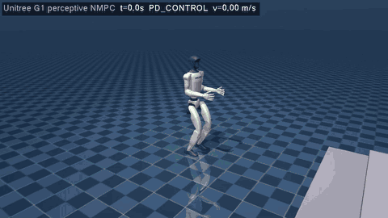
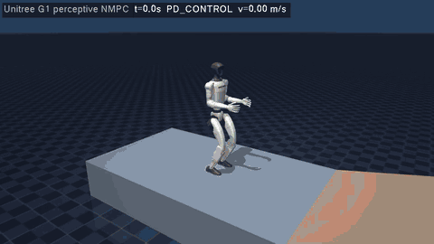
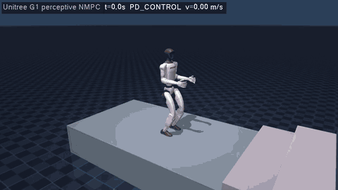

# g1_perceptive_mujoco

Perceptive NMPC for the **Unitree G1 humanoid (12 leg DoF)** in MuJoCo, in **plain C++ and CMake: no ROS, no colcon,
no ament**. It combines the G1 model and biped MPC of [`g1_walking_mujoco`](../g1_walking_mujoco) with the terrain
perception of the ANYmal C package [`anymal_perceptive_mujoco`](../anymal_perceptive_mujoco). The elevation map is
ray cast **straight from the MuJoCo scene** (one `mj_ray` per cell). No elevation_mapping, grid_map or other
perception packages are used.



*Lock-step run over the terrain course (3x speed): 4 stairs up (0.08 m rise, 0.45 m tread), platform, 3 stairs down,
rough blocks. Green cells are steppable, red cells are not.*

## How it works

```
 MuJoCo scene ──mj_ray per cell──▶ TerrainMap (raw → filled → smooth / inflated / steppable / edge distance)
                                        │  20 Hz, robot-centric 3.2 x 3.2 m, 2 cm
                                        ▼
 velocity command ──▶ PerceptiveReferenceManager (before every MPC solve)
                        1. pelvis reference lifted onto the terrain under the feet (pelvis kept level)
                        2. joint posture reference: 6D IK of both soles, flat on the terrain under them
                        3. foothold per foot and future stance: toe AND heel on steppable cells, one level,
                           each with its own convex region
                        4. swing z splines: lift-off / touch-down heights + obstacle apex
                                        │
                                        ▼
 OCS2 centroidal NMPC (SLQ, 100 Hz) ── toe + heel contacts per foot; soft constraints: friction cones, joint limits,
                                        │   foot placement regions, swing toe / heel / ankle and shin clearance
                                        ▼
 RNEA whole-body torques + acceleration feedforward + joint PD (1 kHz) ──▶ MuJoCo
```

| Part | File | What it does |
|------|------|--------------|
| Elevation mapper, terrain map | `terrain/MujocoElevationMapper`, `terrain/TerrainMap` | Same as the ANYmal package (the G1 geoms are in groups 2/3, the rays only hit groups 0/1) |
| Foothold planner | `terrain/FootholdPlanner::selectFoot` | Searches the sole centre around the Raibert foothold; a candidate is valid only if **both the toe and the heel** are on steppable cells, ≥ `minEdgeDistance` from an edge and on one level (no sole straddling a step nose). Falls back to "steppable + level", then to the nominal sole |
| Reference manager | `reference_manager/PerceptiveReferenceManager` | Footholds per foot (contacts f and f + 2), pelvis height over the terrain, posture by `controller/LegPostureIk::solveFeet` |
| Constraints | `constraint/TerrainConstraints`, `constraint/JointLimitsConstraint.h` | Foot placement (toe, heel), swing clearance (toe, heel, and the ankle 6 cm above the map), shin clearance in swing (30 % / 70 % from ankle to knee), URDF joint limits |
| OCS2 problem | `G1Interface` | Biped contact model of `g1_walking_mujoco` (toe 3 rows + heel 2 rows + ankle roll lock) plus the perceptive terms |
| Controller | `controller/G1Controller` | FSM, velocity commands, MPC/MRT, RNEA torques with the planned joint accelerations as feedforward, torque-level joint PD |
| Visualisation | `visualization/TerrainVisualizer` | Map, footholds and pelvis reference as MuJoCo decoration geoms (GUI and recorder) |

### What it took for a humanoid (compared with the ANYmal package)

* **Soles, not points.** A 17 cm sole must land on one tread: toe and heel are checked together. On 0.35 m treads the
  valid window for the sole centre was only a few cm wide, so the course uses 0.45 m treads.
* **Clearance consistent with the footholds.** If the swing clearance layer is inflated more than footholds are kept
  away from risers, the clearance barrier pushes the landing foot onto the next step (inflation 0.03 m <
  desired edge distance 0.08 m). The barrier is active from lift-off (`mu 0.1`), otherwise toes catch the risers.
* **Joint limits in the MPC.** Without them the planned ankle pitch passes the G1 limit (−0.87 rad) on stairs, the real
  ankle saturates and the sole tilts.
* **Whole-body control.** The acceleration-level joint PD of the RNEA conversion is scaled by the joint inertia: about
  4 Nm/rad at the ankle, so swing feet were limp. A torque-level joint PD (100 Nm/rad) and the planned joint
  accelerations as feedforward fix the swing tracking; without the feedforward the swing feet lag and land short.

## Build

Same dependencies as the other no-ROS packages: CMake ≥ 3.16, GCC with C++17, Eigen3, Boost, urdfdom,
**pinocchio 3**, **MuJoCo ≥ 3.0**; GLFW3 + OpenGL for the GUI and `--record`.

```bash
pip install pin cmeel-urdfdom-headers          # pinocchio 3 (or robotpkg / any pinocchio 3 install)
export MUJOCO_DIR=/path/to/mujoco-3.3.0         # MuJoCo release directory
src/g1_perceptive_mujoco/scripts/build.sh       # -> build/g1_perceptive/
```

## Run

```bash
# interactive MuJoCo GUI on the terrain course (keys 2 -> 3 -> 4 in the terminal, then W/A/S/D)
build/g1_perceptive/g1_perceptive_mujoco

# scripted, deterministic run over the whole course; exit code 0 = goal reached without falling
build/g1_perceptive/g1_perceptive_mujoco --headless --vx 0.25 --goal-x 8.4 --log run.csv

# the same with a blind MPC (flat-ground assumption), for comparison
build/g1_perceptive/g1_perceptive_mujoco --headless --vx 0.25 --goal-x 8.4 --blind

# flat ground
build/g1_perceptive/g1_perceptive_mujoco src/g1_perceptive_mujoco/robots/g1/scene.xml

# offscreen GIF (ffmpeg; xvfb-run without a display), unit test + closed-loop course test
src/g1_perceptive_mujoco/scripts/make_gif.sh
(cd build/g1_perceptive && ctest --output-on-failure)
```

Keys as in `g1_walking_mujoco`, plus `M` to toggle the map / foothold display. Headless options as in the ANYmal
package: `--duration`, `--vx`, `--goal-x`, `--gait`, `--base-height`, `--walk-start`, `--start-y`, `--log`, `--blind`,
`--task`, `--report-hits`, `--record` with `--width --height --fps --scale --playback --map-stride`, `--no-map`.
`scripts/generate_terrain.py` regenerates the course; any geoms in group 0 or 1 of a scene that includes
`g1_12dof.xml` are seen by the map.

## Results (headless, lock-step, `scene_terrain.xml`, walk gait)

The shipped `task.info` was chosen on a grid of 3 speeds (0.2, 0.25, 0.3 m/s) x 5 lateral start offsets
(0, ±0.15, ±0.3 m), then checked on a second grid that was not used for tuning (0.22 and 0.27 m/s, offsets
±0.05/0.1/0.2 m).

| Runs | Course completed (goal x = 8.4 m) |
|------|-----------------------------------|
| tuning grid, 15 runs | 14 (the failure: 0.25 m/s, y = −0.15, on the stairs down) |
| validation grid, 10 runs | 9 (the failure: 0.27 m/s, y = 0.1, at the bottom of the stairs down) |
| `--blind` (flat-ground MPC), 0.25 m/s | 0: falls at the first step, x = 1.8 m |
| `scene.xml` (flat), 0.4 m/s | reached x = 3 m |
| `--gait trot`, 5 runs (0.2 – 0.3 m/s, offsets 0 / ±0.15 / ±0.3 m) | 4 (the failure: 0.3 m/s on the stairs up) |
| `--gait quick_trot`, the same 5 runs | 5 |

Runs are close to deterministic: repeated runs of the same variant gave the same result.
Timing on a 4-core cloud VM, one run at a time: MPC 7.5 ms on average (20 ms max) at 100 Hz, elevation map
6.5 ms at 20 Hz. The course takes about 41 s simulated, 38 s wall time.

## Parkour course (work in progress)



*Ramp (12 deg), two 0.10 m hurdles and a 0.15 m step up and down, `task_parkour.info`, 0.25 m/s, 3x speed
(`generate_parkour.py --sections ramp,hurdles,bigstep`). Completed without a fall.*



*Full course (`scene_parkour.xml`), 0.25 m/s, 3x speed: 0.12 m stairs up and down and the 0.10 / 0.15 / 0.20 m gaps,
then a fall on the stepping stones at x = 10.5 m (the furthest of all full-course runs so far).*

`scripts/generate_parkour.py` builds a harder course on top of a pit floor 0.5 m below the start level
(`robots/g1/scene_parkour.xml`, goal x = 21.37 m; `--level hard` writes a harder variant with 0.15 m stairs,
0.20 - 0.30 m gaps, an 18 deg ramp, 0.15 m hurdles and a 0.20 m step). Sections: 0.12 m stairs, gaps of 0.10 / 0.15 /
0.20 m, stepping stones, a 12 deg ramp, 0.10 m hurdles, a 0.15 m step. `--sections a,b -o file.xml` writes single
sections for testing, `--param section.key=value` overrides a dimension (e.g. `--param stones.length=0.4`).

```bash
build/g1_perceptive/g1_perceptive_mujoco src/g1_perceptive_mujoco/robots/g1/scene_parkour.xml \
  --task src/g1_perceptive_mujoco/config/mpc/task_parkour.info --headless --vx 0.25 --goal-x 21.37 --trace run.csv
```

`config/mpc/task_parkour.info` = `task.info` plus the options added for it (all off by default in `task.info`):

| Option | What it does |
|--------|--------------|
| `elevation_mapper.processing.gapFillRadius` | Morphological closing of the smooth layer: narrow pits do not pull the pelvis reference and the leg posture down |
| `foothold.maxStepHeight` | Rejects footholds far above / below the foot's previous stance (pit floors) |
| `foothold.expandedSearchFactor` | Second, wider search when the nominal sole is over a gap wider than the search radius |
| `foothold.minLateralOffset` | Each sole stays on its own side of the pelvis line (no crossed legs); off by default, did not improve the full course (0/5 runs) |
| `swing_trajectory_config.stepDownApexPhase` | Apex later in the swing when stepping down, so the heel does not drop onto the nose it leaves |
| `perception.clearanceGradientScale` | Scale of the sideways map gradient in the clearance constraints (1: as before) |

`--trace FILE.csv` logs, every 10 ms, the pelvis, the toe / heel positions, the next planned footholds, the toe / heel
positions the MPC predicts 0.2 s ahead, joint angles and torques.

Per-section results with `task_parkour.info` (3 speeds x 3 lateral offsets, 9 runs each, normal level): gaps 9/9,
stairs 7/9, single 0.15 m step 6/9, stepping stones 3/9; with smaller sizes: 0.10 m stairs 9/9, 0.12 m step 8/9,
12 deg ramp 8/9, 0.10 m hurdles 6/9, 0.40 m long stones 2/9. **The full course has not been completed**: 0 of 11
runs in a 5-minute loop (0.2 - 0.3 m/s, offsets up to 0.1 m); they fall on the 0.12 m stairs down or on the stones. Step-downs are the weak spot: the hip / knee torques saturate and the swing foot lands short, both effects of
the single-rigid-body model (the G1 legs are 45 % of the mass) and of the RNEA + PD whole-body control.

## Notes and limitations

* Perfect state estimation, noise-free map from the scene geometry.
* Fixed gait timing (walk: 0.4 s single support + 0.2 s double support), stair treads of 0.45 m. Shallower treads
  (0.35 m) leave too little margin for the landing error of this controller.
* Toe + heel line contacts: like g1_control the MPC has no lateral centre of pressure inside a sole; lateral balance
  comes from foot placement only.
* The ankle housings and shins still touch the tread they stand on or a step nose briefly (0.1 – 2 s per run in
  the report, `--report-hits` lists them).
* DDP enforces the inequalities as relaxed barriers; a failed solve restarts the solver and the last policy is kept.
