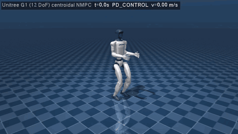

# g1_walking_mujoco

Centroidal NMPC for the **Unitree G1 humanoid (12 leg DoF)** in MuJoCo, in **plain C++ and CMake: no ROS,
no colcon, no ament**. Same layout and controller structure as the ANYmal C package
(`anymal_perceptive_mujoco`); the robot model and the MPC formulation follow
[cyugai/g1_control](https://github.com/cyugai/g1_control) (a ROS 2 package), ported without ROS.



*Lock-step run (1.5x speed): PD stand-up, MPC double support, walk gait at 0.4 m/s for 2.5 m, stop.*

## How it works

```
 keyboard / Xbox / script ──▶ FSM (PASSIVE / PD_CONTROL / STANDING / WALKING)
                                   │ velocity + height command
                                   ▼
                     command trajectory (base x, y, z, yaw) + leg IK posture for the height
                                   │
                                   ▼
 OCS2 centroidal NMPC (SLQ, 100 Hz) ── 4 point contacts: toe + heel of each foot
                                   │   friction cones, zero force in swing, stance velocity,
                                   │   swing height splines, ankle roll lock
                                   ▼
 RNEA whole-body torques + joint PD (1 kHz) ──▶ MuJoCo (12 torque motors)
```

| Part | File | What it does |
|------|------|--------------|
| OCS2 problem | `G1Interface` | Single rigid body centroidal dynamics (CppAD), base / joint tracking cost, contact constraints |
| Contact modes | `gait/MotionPhaseDefinition.h` | `STANCE`, `LCONTACT` (left foot down), `RCONTACT`, `FLY`; contacts `{l_foot_toe, r_foot_toe, l_foot_heel, r_foot_heel}` |
| Stance constraints | `constraint/ZeroVelocityConstraintCppAd`, `constraint/HeelVelocityConstraint.h` | Toe velocity = 0 (3 rows). Heel velocity perpendicular to the toe-heel axis = 0 (2 rows): along the axis it always equals the toe velocity, so a 3D heel constraint would make the constraints rank deficient and every SLQ solve fail |
| Ankle roll | `constraint/FootRollConstraint.h` | Ankle roll joint velocity = 0: the toe-heel line contact gives no support about the sole axis (as in g1_control) |
| Swing | `foot_planner/SwingTrajectoryPlanner` | Cubic z splines for toe and heel (8 cm apex), so the sole stays level |
| Gaits | `config/command/gait.info` | `walk` (0.4 s single + 0.2 s double support), `trot` (alternating 0.45 s steps), `quick_trot` (0.3 s) |
| Posture | `controller/LegPostureIk` | Joint reference for the commanded pelvis height: damped least squares on the 6D foot poses (feet flat on the default footprint) |
| Controller | `controller/G1Controller`, `MujocoG1Bridge` | FSM, velocity commands, MPC/MRT, RNEA + PD torques. MuJoCo and Pinocchio joints are matched by name |

`cmake/Ocs2Standalone.cmake` compiles the needed OCS2 libraries straight from `src/ocs2_ros2`.

One fix in the vendored OCS2 came with this package: `CentroidalModelRbdConversions::computeRbdTorqueFromCentroidalModelPD`
now **adds** the contact forces of all contact points that share a parent joint. Before, the heel force overwrote
the toe force (both hang off the ankle roll link) and the robot fell as soon as the MPC took over. For robots with one
contact per link (ANYmal, Go1, Go2) the result is unchanged.

## Build

Dependencies: CMake ≥ 3.16, GCC with C++17, Eigen3, Boost (filesystem, log), urdfdom, **pinocchio 3** and
**MuJoCo ≥ 3.0**. GLFW3 and OpenGL are optional; you need them for the GUI and `--record`.

```bash
sudo apt install build-essential cmake libeigen3-dev libboost-all-dev liburdfdom-dev libglfw3-dev libgl-dev ffmpeg
pip install pin cmeel-urdfdom-headers          # pinocchio 3 (or robotpkg / any pinocchio 3 install)
export MUJOCO_DIR=/path/to/mujoco-3.3.0         # MuJoCo release directory
```

From the repository root (output in `build/g1_walking`):

```bash
src/g1_walking_mujoco/scripts/build.sh
```

The package has a `COLCON_IGNORE`, so a `colcon build` of the ROS workspace skips it.

## Run

```bash
# interactive MuJoCo GUI (keyboard in the terminal, or an Xbox pad): 2 -> 3 -> 4, then W/A/S/D
build/g1_walking/g1_walking_mujoco

# scripted, deterministic run (lock-step: the physics waits for every MPC solve); exit code 0 = goal reached, no fall
build/g1_walking/g1_walking_mujoco --headless --vx 0.3 --goal-x 2.0 --log run.csv

# other gaits / commands
build/g1_walking/g1_walking_mujoco --headless --gait trot --vx 0.3 --goal-x 2.0
build/g1_walking/g1_walking_mujoco --headless --vx 0.2 --yaw-rate 0.3 --duration 15
build/g1_walking/g1_walking_mujoco --headless --vx 0.3 --goal-x 2.0 --push 7,0,150   # lateral push while walking

# offscreen video / GIF (ffmpeg; xvfb-run without a display)
src/g1_walking_mujoco/scripts/make_gif.sh

# closed-loop tests (stand, walk 2 m)
(cd build/g1_walking && ctest --output-on-failure)
```

| Key (terminal) / pad | Action |
|-----|--------|
| `1` / A | PASSIVE |
| `2` / B | PD stand-up |
| `3` / X | STANDING (MPC, double support) |
| `4` / Y | WALKING (MPC, walk gait) |
| `W` `S` / `A` `D` | forward / lateral velocity |
| `J` `L` | yaw rate |
| `G` / RB | next gait (walk → trot → quick_trot) |
| `-` `=` | pelvis height (0.66 – 0.75 m while walking) |
| `Q` | emergency stop |

Headless options: `--duration S`, `--vx V`, `--vy V`, `--yaw-rate W`, `--goal-x X`, `--gait NAME`, `--base-height H`,
`--walk-start T`, `--push T,FX,FY` (0.1 s force on the pelvis), `--log FILE.csv`, `--task FILE`,
`--record FILE.gif|mp4` with `--width --height --fps --scale --playback`.

## Results (headless, lock-step, flat ground)

| Run | Result |
|-----|--------|
| stand 8 s (`ctest g1_stand`) | stable, pelvis 0.731 m |
| walk 0.3 m/s to x = 2 m, stop (`ctest g1_walk`) | reached, no fall |
| walk 0.5 m/s to x = 3 m | reached |
| `trot` / `quick_trot` 0.3 m/s to x = 2 m | reached |
| backwards −0.2 m/s, sideways 0.15 m/s, turning 0.2 m/s + 0.3 rad/s | no fall |
| pelvis height 0.66 / 0.76 m standing, 0.68 m walking | tracked to ±2 mm |
| lateral push while walking, 0.1 s | 60, 100, 150, 200 N: no fall |
| forward push while standing, 0.1 s | 80 N: no fall; 120 N: falls (no stepping reflex in STANDING) |

MPC solve on a 4-core cloud VM: 2.4 ms on average standing, 6 ms walking (max ~25 ms), at 100 Hz.

## Configuration

* `config/mpc/task.info`: `Q`/`R` weights (from g1_control), friction, swing height, DDP/MPC settings,
  `controller` gains, `g1_interface.contactHeight` (contact frames 5 mm above the ground in stance).
* `model_settings.recompileLibrariesCppAd`: generates the CppAD libraries in `/tmp/g1_walking_mujoco` on start-up.
  Set it to `false` to reuse them on later runs.
* `config/command/gait.info`: biped gaits; `config/command/reference.info`: default posture.
* `robots/g1/`: `urdf/g1_12dof.urdf` (MPC model), `g1_12dof.xml` + `scene.xml` (MuJoCo). Waist and arms are fixed.

## Notes and limitations

* State estimation is perfect (taken from the simulator).
* The MPC uses SLQ (DDP) as in the ANYmal package; g1_control uses SQP/IPM with HPIPM, which this plain-CMake build
  does not compile.
* The whole-body control is RNEA + joint PD on the MPC solution (no QP WBC as in g1_control); it has no base feedback.
* No stepping reflex in STANDING: large pushes need WALKING.
