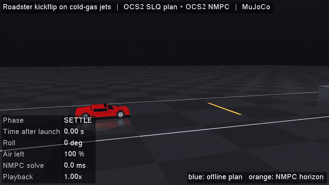

# Roadster Kickflip on Cold-Gas Jets (OCS2 + MuJoCo)



A 2 t sports car drives at 18 m/s towards a row of parked vehicles (the tallest is 4 m), lifts off on 12 on/off
compressed-air jets, does a full barrel roll over the row and lands back on its wheels.

Inspired by the Tesla Roadster demo. The car, jet layout and scene follow
[xkhainguyen/roadster-stunt](https://github.com/xkhainguyen/roadster-stunt) (MIT). That project uses
CasADi/IPOPT + LQR + TinyMPC; here the planning and flight control are done with OCS2. Every number is an
estimate, not a Tesla figure, and nothing here is affiliated with Tesla.

## How it works

| Stage | Tool | What it does |
|-------|------|--------------|
| **Plan** | OCS2 SLQ (offline, ~0.7 s) | Optimizes the whole 2.6 s flight on a planar roll model. Jet limits (at 90 %) and the clearance over the row are relaxed-barrier soft constraints. A rough hand-designed guide (climb, cruise, descend, roll 0 to 360°) is tracked loosely. |
| **Fly** | OCS2 NMPC (`GaussNewtonDDP_MPC` + `MPC_MRT_Interface`) | 1 s horizon, solved at 50 Hz in simulation time, warm-started from the plan. Its linear feedback policy runs at 100 Hz. It tracks the plan, then lands with a slow constant sink. |
| **Jets** | `JetController` | Adds a pitch/yaw hold (the planar model does not see them), allocates the wrench to the 12 jets with bounded least squares, and drives each on/off valve with a sigma-delta modulator. An air tank limits the total impulse to 180 kN s. |
| **Physics** | MuJoCo | Free-flying car with suspension and wheels, jets as site actuators, contacts with the road and the parked row. |

**Model** (`RoadsterDynamics`): state `[y, z, vy, vz, roll, rollRate]`, input `[lift_L, lift_R, roof_L, roof_R]`
in kN (front and rear jet of one side summed). x is decoupled (`x = 18 m/s * t`).

**Result** (nominal run, `--headless`):
- clears the row by the planned margin with no contact
- touchdown 3.1 s after launch, sink rate 0.26 m/s, roll error < 0.1°
- uses about 100 of the 180 kN s of air
- with the optional gust enabled (4 kN sideways + 6 kN m roll kick at 160° of roll), it still lands at 0.26 m/s
  with a roll error of 0.3°

## Build

```bash
cd ~/ros2_ws_ocs2
colcon build --packages-up-to roadster_stunt
source install/setup.bash
```

Dependencies: `ocs2_core`, `ocs2_oc`, `ocs2_ddp`, `ocs2_mpc`, `ocs2_robotic_tools`, MuJoCo, GLFW3, Eigen3, Boost.

## Run

```bash
# Live window
./install/roadster_stunt/lib/roadster_stunt/roadster_stunt_mujoco --slowmo 0.5

# No window: simulate once and print the touchdown report (exit code 0 when the stunt succeeds)
./install/roadster_stunt/lib/roadster_stunt/roadster_stunt_mujoco --headless --log flight.csv

# Offscreen video or GIF (needs ffmpeg)
./install/roadster_stunt/lib/roadster_stunt/roadster_stunt_mujoco --record stunt.mp4 --width 1280 --height 720 --fps 30 --slowmo 0.5

# The README GIF (uses xvfb-run when there is no display)
src/roadster_stunt/scripts/make_gif.sh
```

| Option | Meaning |
|--------|---------|
| `--headless` | simulate without graphics and print the touchdown report |
| `--record FILE` | render offscreen to `.gif` (own palette) or any other ffmpeg format |
| `--width/--height` | render size (up to 1920x1080) |
| `--scale W` | output width of the recording |
| `--fps F` | recording frame rate |
| `--slowmo S` | playback rate while the car is rolling |
| `--log FILE` | CSV of the flight: state, plan reference, NMPC input, solve time, air left |

**Window controls:** `SPACE` pause, `R` restart, `L` loop, `F` follow camera, mouse to rotate/zoom/pan, `ESC` exit.

In the view, the blue line is the offline plan and the orange line is the current NMPC horizon. The plumes'
brightness follows each jet's average force.

## Configuration

Everything is in `config/task.info`:
- `roadster`, `stunt`: car, jets and scene
- `constraints`: barrier parameters of the jet limits and the clearance
- `plan`, `nmpc`: weights and SLQ settings of the two stages; `mpc`: horizon and rates
- `lowLevel`: pitch/yaw gains, on/off valves
- `simulation`: timing, braking, and the optional `gust` disturbance

## File Structure

```
roadster_stunt/
├── config/task.info
├── robots/roadster.xml            # MuJoCo car + parked row
├── scripts/make_gif.sh            # records doc/gifs/roadster.gif
├── include/roadster_stunt/
│   ├── RoadsterDefinition.h       # state/input layout
│   ├── RoadsterParameters.h       # car and scene parameters
│   ├── RoadsterDynamics.h         # planar roll model
│   ├── ClearanceConstraint.h      # z >= clearance height over the row
│   ├── StuntReference.h           # plan guide, plan -> NMPC targets, initializer
│   ├── RoadsterInterface.h        # OCS2 optimal control problem
│   └── JetController.h            # pitch/yaw hold, allocation, valves, air tank
└── src/
    ├── ... (implementations)
    └── main_roadster_mujoco.cpp   # plan, closed loop, viewer, recorder
```
